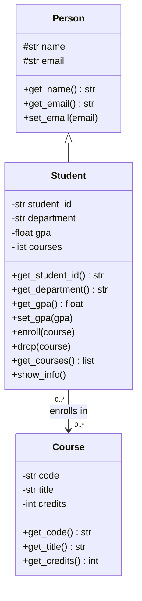

# Student Class Diagram

Ahmet Atmaca - 20230526 (`20230526@std.neu.edu.tr`)

Mapping a simple student class diagram to python code for the Software Implementations assignment.



`Student` extends `Person` and keeps a list of `Course` objects. Protected fields use `_`, private fields use `__` with getters and setters.

To run:
```bash
python3 main.py
```
